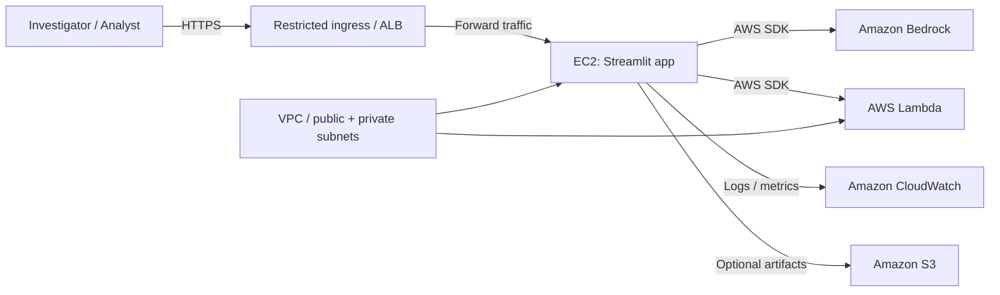

# ARCHITECTURE

## Overview

This repository is a working prototype for an investigative research assistant. The current implementation is intentionally lightweight: a Streamlit front end coordinates user questions, delegates intent routing to Amazon Bedrock, calls AWS Lambda functions for data retrieval, and assembles findings into an investigative report.

This document captures the current-state architecture for the repo as it exists today and the near-term target-state architecture for a pilot deployment. It is structured as an internal engineering handoff and is intended for a junior engineer taking ownership of the effort.

## Current state (POC)

The current application is designed to run as a single EC2-hosted Streamlit service in AWS commercial us-east-2. The EC2 instance hosts the front end and connects to AWS APIs using the instance identity and role-based permissions available in the environment.

The Streamlit UI accepts investigator questions and routes them through the following flow:

1. User submits a natural-language question in the Streamlit interface.
2. The app calls Bedrock to classify the request and determine the most relevant data source.
3. The app invokes one of the configured AWS Lambda functions over the AWS SDK.
4. The selected Lambda function returns structured results, including answer text, SQL, and/or findings.
5. The app optionally asks Bedrock to translate SQL into plain-English query logic and to synthesize a final markdown report.
6. The report is assembled from saved findings and is downloadable as a Word document.

### Repository map and how the pieces fit together

The repository is deliberately small and readable so a new engineer can follow the full application lifecycle without needing deep tribal knowledge. Each top-level component exists for a specific responsibility.

- `app.py`: the application entry point and the primary orchestration layer. This is where the Streamlit UI is defined, user questions are managed, conversation state is assembled, and the app decides which AWS actions to invoke.
- `app_utils.py`: shared helper logic for AWS calls, request serialization, and context trimming. It keeps the main app cleaner and makes testing easier by isolating the AWS wrapper behavior.
- `requirements.txt`: runtime package list for the application. This defines the production dependencies that are required for the app to function on EC2.
- `requirements-dev.txt`: developer tooling including test execution and baseline security scanning.
- `terraform/`: baseline infrastructure-as-code for the EC2, VPC, IAM, and logging model used by the current deployment pattern.
- `scripts/`: deployment scripts and the systemd service definition used to keep the Streamlit app running on the EC2 host.
- `.github/workflows/`: deployment automation so changes can be promoted to the EC2 runtime in a repeatable way.
- `tests/`: automated validation for the helper layer and other key logic that should remain stable over time.
- `DATA_SOURCES.md`: defines the expected source categories and data contracts without committing actual sensitive or operational data.
- `RUNBOOK.md`: operational guidance for troubleshooting, deployment validation, and handoff tasks.
- `DEPLOYMENT_CHECKLIST.md`: pre-deployment review and validation checklist for moving from POC to pilot-ready state.

In other words, the repository is structured as a lightweight but understandable system: the application logic lives in the Python app, the AWS integrations are abstracted into helper functions, deployment automation lives under scripts and GitHub workflows, and the infrastructure baseline lives in Terraform.

## Future-state / pilot architecture

The near-term target is a more resilient pilot deployment:

- EC2 hosts the Streamlit service in a VPC-based network boundary.
- Application Load Balancer (ALB) or Network Load Balancer (NLB) terminates TLS and forwards traffic to the EC2 host.
- Private subnets host the application tier and AWS-managed service connectivity.
- Public subnets are reserved for ingress only when needed per security model.
- Lambda functions are retained for targeted retrieval and orchestration.
- Bedrock remains the model layer for intent classification, explanation, and report synthesis.
- CloudWatch provides operational telemetry, logs, and alerts.
- IAM roles replace static credentials where possible.

## AWS service view

The relevant AWS components in the current repo flow are:

- Amazon EC2: application host for the Streamlit service
- AWS Lambda: data retrieval and domain-specific processing handler
- Amazon Bedrock: intent routing, explanation generation, and report synthesis
- Amazon CloudWatch: logs and operational observability
- AWS IAM: permissions and least-privilege access model
- Amazon S3: optional artifact storage or document staging (if used in a later pilot)
- VPC / private subnets: network isolation for the app and backend access

## Data flow

Data flows through the application in the following sequence:

1. User traffic enters the environment via the public or restricted access layer.
2. The request reaches the Streamlit service on the EC2 host.
3. The service calls Bedrock over HTTPS on port 443 to classify the request and generate explanations or report content.
4. The service calls AWS Lambda over the AWS API endpoint on port 443 using the execution role attached to the EC2 instance.
5. The Lambda function returns structured data to the application.
6. The application serializes result sets and assembles a narrative report for the analyst.

### Transport and protocol summary

- Ingress to EC2 or ALB: HTTPS (TCP 443), optionally HTTP to ALB with TLS termination
- Internal app streaming: local HTTP on EC2 port 8501 for the Streamlit server
- AWS service calls: HTTPS (TCP 443) via boto3 and AWS SDKs
- Lambda invocation: AWS API over HTTPS
- Bedrock model calls: AWS API over HTTPS
- Logs and metrics: CloudWatch APIs over HTTPS

## Network model

This is expected to be deployed in a standard VPC layout in us-east-2:

- Public subnet: optional ingress, NAT, or management access
- Private subnet: EC2 application host and internal services
- Security groups: restrict inbound access to required ports only
- Internet-facing ALB or restricted public load balancer: allowable only under a least-access design
- Private VPN / private networking: preferred option for production governance and reduced exposure

In the current prototype, the immediate goal is to keep the application understandable and secure without overengineering the network. The future pilot should explicitly choose between:

- private-only access via VPN or private network path, or
- restricted public access through a controlled load balancer with guardrails.

## End-to-end request lifecycle

The clearest way to understand the repository is to follow one user question from the UI to the final answer and report. That end-to-end flow is the core of the application and it ties every major repository component together.

### 1. User enters a question in the app

The investigator opens the Streamlit UI hosted on EC2. The app is served on a local port, typically 8501, and the interface accepts natural-language questions in a browser session.

This portion of the system is driven by the Python code in `app.py`. It sets the page configuration, maintains basic state, and captures the user input. The app can also retain short conversational context for a session so a user can ask follow-ups without starting over.

### 2. The app prepares request context

Before invoking AWS tools, the app builds a clean request payload. This includes the latest user question, short prior conversation history, and any relevant metadata needed for the downstream routing decision.

This is the role of the helper code in `app_utils.py`. The AWS wrappers are intentionally separated from the app logic so the main app remains readable and unit tests can validate behavior without hitting real cloud resources.

### 3. Bedrock classifies the request and selects the right source

The app uses Amazon Bedrock to classify the user inquiry and determine which data source category is most relevant. The repository is designed around the following broad categories:

- transactional data
- investigative reports
- manuals and reference material

The model layer decides which class of information best matches the request, often enabling a more targeted, efficient retrieval workflow. This reduces the chance that the system searches broadly across unrelated sources and improves the quality of the final response.

### 4. The app invokes AWS Lambda functions for retrieval

Once the intent is classified, the app calls AWS Lambda functions through the AWS SDK. The Lambda layer is the retrieval and processing boundary for data lookup, query generation, and response shaping. In a real deployment, the Lambda function might run a database query, pull structured results, or retrieve a relevant document set.

This is where the architecture becomes practical: the app itself is just the workflow orchestrator, while AWS-managed services handle the heavier logic and secure access patterns.

### 5. The app interprets and explains the result

The raw retrieval results can come back in structured or semi-structured form. The app then formats the response for the investigator. In some cases, a Bedrock step is used to explain SQL or convert query logic into plain-language terms, making the result more understandable to the end user.

This is one reason the repo includes both classification and explanatory model logic. The workflow is not simply a raw data dump; it is designed to help an investigator understand what happened, why the result matters, and how the answer maps back to a question.

### 6. The app assembles a report or final answer

The final stage is report synthesis. The app can turn the collected findings into a narrative summary and, where applicable, produce a document-friendly report. This fits the use case for investigative workflows where the analyst needs to document findings, share them, or continue with follow-up work outside the chat interface.

The primary output is not just a short answer but a usable investigation artifact that can be reviewed and handed off.

## How AWS and automation fit together

The repository is built around a practical AWS pattern rather than a purely local application model.

- EC2 provides the application host for the Streamlit service.
- IAM roles and instance profiles supply runtime access to AWS services without embedding long-lived credentials in the repo.
- Amazon Bedrock provides the classification, explanation, and report synthesis logic.
- AWS Lambda performs targeted retrieval or processing tasks.
- CloudWatch captures operational logs and service health information.
- Terraform codifies the infrastructure baseline so the environment can be recreated consistently.
- GitHub Actions and shell scripts automate deployment to the EC2 host.

This is the system-level view: the code in the repo is not standalone in isolation. It depends on a broader AWS environment to provide runtime, networking, model access, and operational monitoring.

## Security posture and operational assumptions

This repo is a prototype and should be treated as a POC until formal security review is completed. The intended security baseline is straightforward and explicit:

- no hardcoded AWS credentials in committed source files
- use of IAM roles and EC2 instance profiles wherever possible
- no secrets in `.env` committed to the repo; `.env.example` is a template only
- least-privilege AWS policy design for EC2 and Lambda roles
- CloudWatch logging for failures, model calls, and access events
- regular dependency and security scanning before broader pilot rollout

This is intentionally not an overbuilt production security model. The goal is to keep the system understandable and secure enough for a handoff while leaving room for formal hardening later.

## Current-state diagram

## Near-term pilot target

The target architecture should evolve toward a more controlled deployment model:

- EC2 behind ALB/NLB with private networking preferred
- dedicated IAM roles for app and Lambda execution
- restricted ingress rules and explicit security groups
- CloudWatch dashboards and alert thresholds for service health
- structured deployment pipeline and configuration management

This gives the team a clear path from prototype to pilot without prematurely locking in an overbuilt production control plane.

## Ownership and next steps

The repository is now structured so a junior engineer can understand the system and continue from a documented baseline. The immediate next steps are:

1. Validate the live AWS resources against the documented architecture.
2. Convert manual infrastructure into Terraform.
3. Add environment-specific deployment configuration for EC2 and service discovery.
4. Expand test coverage and CI validation.
5. Harden IAM and network restrictions before expansion beyond the pilot.

## Summary

This repo is not just a single Python script. It is a compact, end-to-end investigative workflow with the following layered responsibilities:

- the Streamlit app provides the front end and interactive experience
- the Python helper layer wraps AWS behaviors in clean, testable functions
- Amazon Bedrock provides the intelligence layer for classification and explanation
- Lambda functions provide retrieval and data-side processing
- EC2 hosts the service in a realistic AWS deployment model
- Terraform and deployment scripts codify how the environment is created and maintained
- documentation and checklists help a new engineer understand the system without relying on undocumented tribal knowledge

When all of those parts work together, the user sees a simple investigator-facing experience, but behind the scenes the repo contains the complete flow for intake, classification, retrieval, synthesis, and reporting. That is the architectural story of the project and the reason the repository is structured the way it is.
