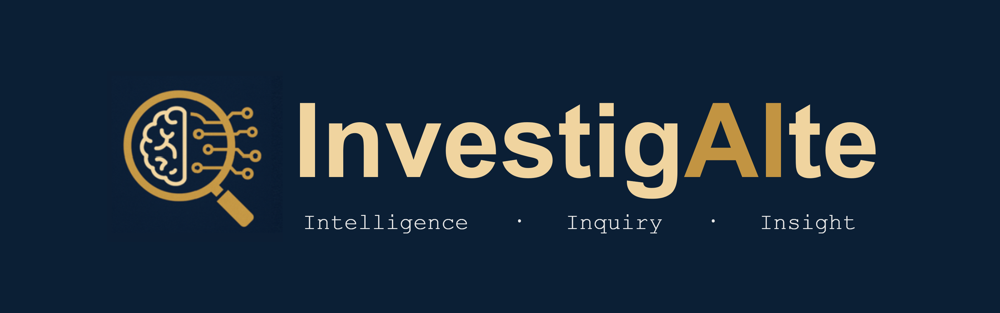

## Overview

InvestigAIte helps investigators gather information from multiple sources and turn it into a concise, report-ready summary. The app supports natural-language questions, routes the request to the best data source, and brings the result together in a single review flow.

The current repository is a working baseline for an investigator-facing workflow. It is intended to reduce manual research effort and help analysts focus on case evaluation rather than repeated data collection.

## Project purpose

The system is meant to help investigators answer questions spanning three core categories:

- transactional data for patterns, trends, and activity analysis
- investigative reports for prior case history, findings, and related context
- manuals and reference materials for regulatory and procedural guidance

Workflow:

1. a user asks a question in the Streamlit UI
2. an Amazon Bedrock model classifies the request and selects the best source
3. AWS Lambda functions retrieve the relevant information
4. the app composes a summary and can build a report from saved findings

## Default stack and runtime

The repository is set up for a Python-based EC2 deployment rather than a workstation-only setup.

- recommended Python version: 3.13.x
- target deployment model: EC2 in AWS us-east-2
- current repo state: working baseline for a future operational deployment

## Current architecture

The repo currently contains:

- `app.py`: Streamlit application and investigative workflow
- `app_utils.py`: reusable AWS helper functions for Lambda invocation and context building
- `requirements.txt`: runtime dependencies
- `requirements-dev.txt`: developer and test tooling
- `ARCHITECTURE.md`: architecture overview, repository map, and end-to-end workflow

See [ARCHITECTURE.md](ARCHITECTURE.md) for the detailed AWS architecture, repository map, and end-to-end flow.

## AWS deployment model

The current repo assumes the app runs on an EC2 instance in AWS us-east-2 with a standard VPC layout. The intended traffic flow is:

- user access through a restricted ingress path, private network, or controlled public access model
- the Streamlit service runs on the EC2 host
- the app calls Amazon Bedrock for routing and synthesis
- the app calls AWS Lambda for targeted retrieval workflows
- CloudWatch is used for logs and operational monitoring

This is a working baseline for a future deployment and is intended to be reviewed against the live AWS environment before broader rollout.

## Infrastructure as code

The repository includes a Terraform baseline in [terraform/README.md](terraform/README.md) for the current EC2, VPC, IAM, and logging pattern. This is meant to support validation of the manually created AWS resources and move the setup toward an infrastructure-as-code workflow.

The Terraform baseline reflects the current architecture assumptions without locking in a final production design. Validate the live AWS inventory before using it as the source of truth for an operational environment.

## Local setup

Use a Python 3.13 virtual environment for local validation. The examples below use bash commands, with a short PowerShell example when needed.

### 1. Clone the repository

```bash
git clone <repo-url>
cd demo-investigAIte
```

### 2. Create a virtual environment

```bash
python3.13 -m venv .venv
source .venv/bin/activate
```

On Windows PowerShell:

```powershell
py -3.13 -m venv .venv
.\.venv\Scripts\Activate.ps1
```

### 3. Install dependencies

```bash
python -m pip install --upgrade pip
python -m pip install -r requirements.txt
python -m pip install -r requirements-dev.txt
```

### 4. Configure environment values

Copy the example env file and update it for the target environment:

```bash
cp .env.example .env
```

On Windows PowerShell:

```powershell
Copy-Item .env.example .env
```

The app expects values such as:

```env
AWS_REGION=us-east-2
ARCOS_LAMBDA_NAME=arcos-nl-sql-handler
DEA6_LAMBDA_NAME=dea6-bedrock-kb-handler
INTENT_MODEL_ID=us.anthropic.claude-sonnet-4-6
EXPLAIN_MODEL_ID=us.anthropic.claude-sonnet-4-6
REPORT_MODEL_ID=us.anthropic.claude-sonnet-4-6
```

Use IAM roles and instance profiles for EC2-based deployment. Keep static AWS credentials only for local troubleshooting and do not commit them to the repo.

### 5. Run the app

```bash
streamlit run app.py
```

For EC2 deployment, use:

```bash
streamlit run app.py --server.address 0.0.0.0 --server.port 8501
```

When working from a Windows workstation, validate the app in a Python virtual environment first and then deploy the same repo to EC2 using the service configuration and deployment automation in this project.

## Developer workflow and quality gates

The project should keep these basics in place:

- unit tests for core logic and helper behavior
- a baseline security review for dependencies and code
- clear architecture and operational documentation
- environment-driven configuration instead of hardcoded secrets

## Testing

The project includes a lightweight test suite for helper logic and AWS integration wrappers.

```bash
python -m pytest
```

## Security baseline

The expected security posture is:

- IAM roles and instance profiles instead of static access keys
- no secrets checked into version control
- least-privilege AWS permissions
- network restrictions based on the deployment environment
- validation of logs, permissions, and dependency hygiene before broader deployment

## Documentation set

- [ARCHITECTURE.md](ARCHITECTURE.md): system overview, repository map, data flow, and end-to-end explanation
- [DATA_SOURCES.md](DATA_SOURCES.md): expected source types, schemas, and safe data-handling guidance

## Contributing

When contributing to this repo:

1. keep application configuration in environment variables
2. prefer IAM-based access over static credentials
3. validate tests before proposing a merge
4. update the architecture when the system changes
5. keep the repo clear and easy for the next engineer to understand

## Notes

This repository is intended to remain understandable to the next engineer without relying on tribal knowledge. The architecture, security posture, and operational flow should stay clear as the project evolves.
