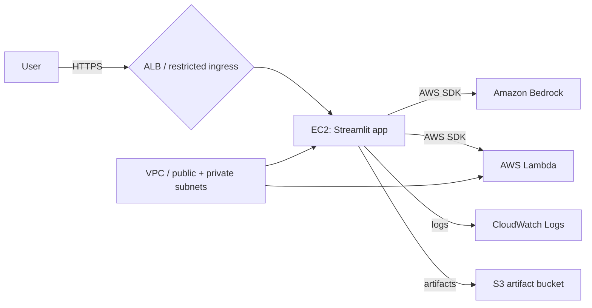

# Terraform baseline for the current architecture

This directory contains a baseline Terraform configuration for the current InvestigAIte proof of concept. The intent is to codify the present deployment assumptions in a repeatable way so the manual AWS setup can be validated and then transitioned into a supported IaC workflow.

## Scope

The baseline is designed around the current repo assumptions:

- EC2-hosted Streamlit application in AWS commercial us-east-2
- standard VPC layout with public and private subnets
- IAM role and instance profile for EC2-based AWS access
- Bedrock and Lambda access through the AWS SDK
- optional ALB front-end toggle for alternate ingress patterns
- CloudWatch logging and S3 artifact storage support

This is intentionally a current-state starting point, not a production-grade reference design. The live AWS environment should be validated against the actual deployed resources before using this as the authoritative source of truth.

## Architecture represented



## Files

- `main.tf` — VPC, subnets, security groups, EC2, IAM role, log group, and optional S3 bucket
- `variables.tf` — configurable deployment inputs
- `outputs.tf` — key values for validation and handoff
- `terraform.tfvars.example` — example variable values for a new deployment

## Recommended workflow

1. Copy the example values:

   ```bash
   cp terraform/terraform.tfvars.example terraform/terraform.tfvars
   ```

2. Update the variable file for the target AWS account and environment.
3. Initialize Terraform:

   ```bash
   cd terraform
   terraform init
   ```

4. Review the execution plan:

   ```bash
   terraform plan
   ```

5. Apply when the plan matches the intended environment:

   ```bash
   terraform apply
   ```

## Important notes

- Replace the placeholder CIDR ranges with the real network ranges used in the environment.
- Keep the ingress model limited to the minimum required access for the pilot.
- Prefer IAM roles and EC2 instance profiles over static AWS access keys.
- Confirm the actual Lambda names and model IDs before using this baseline in a real deployment.
- Treat this as a transition artifact until the AWS environment is validated and the Terraform config is reconciled with the live inventory.
