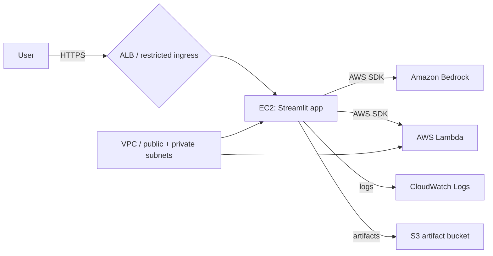

# Terraform baseline for the current architecture

This directory contains a baseline Terraform configuration for the current InvestigAIte proof of concept. The intent is to codify the present deployment assumptions in a repeatable way so the manual AWS setup can be validated and then transitioned into a supported IaC workflow.

## Scope

The baseline is designed around the current repo assumptions:

- EC2-hosted Streamlit application in AWS commercial us-east-2
- standard VPC layout with public and private subnets
- IAM role and instance profile for EC2-based AWS access
- Bedrock and Lambda access through the AWS SDK
- optional ALB front-end toggle for alternate ingress patterns
- CloudWatch logging and S3 artifact storage support

This is intentionally a current-state starting point, not a production-grade reference design. The live AWS environment should be validated against the actual deployed resources before using this as the authoritative source of truth.

## Architecture represented



## Files

- `main.tf` — VPC, subnets, security groups, EC2, IAM role, log group, and optional S3 bucket
- `variables.tf` — configurable deployment inputs
- `outputs.tf` — key values for validation and handoff
- `terraform.tfvars.example` — example variable values for a new deployment

## End-to-end deployment workflow

### 1. Authenticate to AWS

Configure your AWS CLI credentials before you run Terraform.

For a user profile:

```bash
aws configure
```

PowerShell:

```powershell
aws configure
```

Or, if a profile already exists:

```bash
export AWS_PROFILE=my-profile
export AWS_REGION=us-east-2
aws sts get-caller-identity
```

PowerShell equivalent:

```powershell
$env:AWS_PROFILE = "my-profile"
$env:AWS_REGION = "us-east-2"
aws sts get-caller-identity
```

You should see your account ID and ARN. This confirms the CLI is authenticated and ready to use.

### 2. Install Terraform

Use the Terraform installation method approved for the workstation or environment. In a government or enterprise-managed environment, this may be delivered through an internal package repository, a managed software baseline, or the official installer package rather than a local package manager such as winget.

For a Windows workstation where a direct download is required, use the official HashiCorp release page:

- download URL: https://developer.hashicorp.com/terraform/downloads
- choose the Windows AMD64 zip archive
- save the zip to a known location such as `C:\Tools\terraform` or another approved working directory
- extract the `terraform.exe` file
- add the folder containing `terraform.exe` to your system `PATH`

Example PowerShell steps:

```powershell
New-Item -ItemType Directory -Force -Path "C:\Tools\terraform" | Out-Null
# Download the Windows AMD64 zip from the official HashiCorp releases page
# Extract the zip contents to C:\Tools\terraform
$env:PATH += ";C:\Tools\terraform"
terraform version
```

If the organization enforces an approved software baseline, use that managed installation path instead of a local download. The key requirement is that Terraform be installed and validated before running `terraform init` or `terraform plan`.

### 3. Clone and prepare the repo

```bash
git clone <repo-url>
cd demo-investigAIte
```

Then move into the Terraform directory:

```bash
cd terraform
```

### 4. Configure the deployment values

Copy the example variable file and adjust it for the target environment:

```bash
cp terraform.tfvars.example terraform.tfvars
```

PowerShell:

```powershell
Copy-Item terraform.tfvars.example terraform.tfvars
```

Update the values in `terraform.tfvars` so they align with your AWS account and environment. The default file is intentionally simple and suitable for a validation environment.

### 5. Initialize Terraform

```bash
terraform init
```

### 6. Review the deployment plan

```bash
terraform plan
```

Review:

- VPC and subnet definitions
- security groups
- IAM roles
- EC2 instance creation
- CloudWatch log group
- optional S3 bucket creation

### 7. Apply the environment

```bash
terraform apply
```

When prompted, confirm the apply. This creates the validation environment from the current repo baseline.

### 8. Validate the deployed app

Once the EC2 instance is available, connect to it and check the service:

```bash
ssh -i <your-key.pem> ec2-user@<public-ip>
sudo systemctl status investigAIte --no-pager
curl -I http://localhost:8501
```

If the service is running, the app should respond on port 8501.

For a Windows workstation, use the same approach with SSH from PowerShell:

```powershell
ssh -i <your-key.pem> ec2-user@<public-ip>
sudo systemctl status investigAIte --no-pager
curl.exe -I http://localhost:8501
```

If the service is running, the app should respond on port 8501.

### 9. Tear down the validation environment

When validation is complete, tear down the test deployment to avoid leaving AWS resources running:

```bash
terraform destroy
```

This removes the transient VPC, EC2 instance, IAM role, security groups, and any associated validation resources created for the test run.

## Important notes

- Replace the placeholder CIDR ranges with the real network ranges used in the environment.
- Keep the ingress model limited to the minimum required access for the pilot.
- Prefer IAM roles and EC2 instance profiles over static AWS access keys.
- Confirm the actual Lambda names and model IDs before using this baseline in a real deployment.
- Treat this as a transition artifact until the AWS environment is validated and the Terraform config is reconciled with the live inventory.
- Keep the validation deployment isolated and ephemeral so it does not become a permanent environment with lingering cost or risk.
